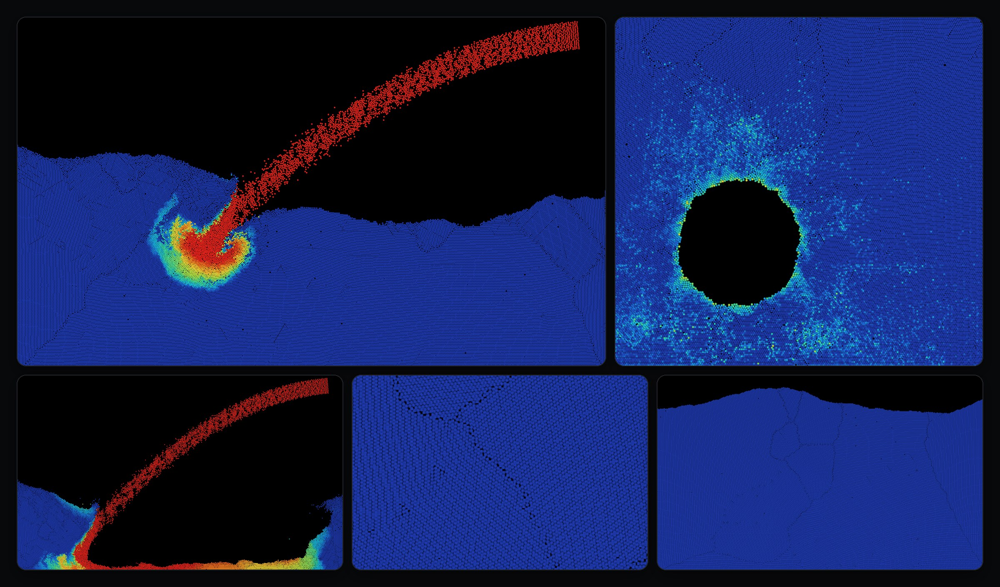

# Particle-Simulation

100,000 particles of sand on the CPU, 4 threads of an M1 MacBook Air, no GPU compute. Pour it, push it, pull it with the mouse.




The colour is heat: kinetic energy on a log scale, blue at rest, red when fast. The thin dark lines in the settled pile are grain boundaries, where two packed regions meet at different angles. Nobody drew them. They come out of the contact solver.

## Where it started

The first version, in SFML with Euler integration and a `std::vector` per grid cell, managed about 700 particles at 60 FPS. That code is in V1 below. This version holds 100,000.

| Version | Particles at 60 FPS | What changed |
|---|---|---|
| SFML prototype | ~700 | Euler, array of structs, one draw call per particle |
| V7 (single thread) | 17,000 | Verlet, struct of arrays, uniform grid sorted every frame |
| Now (4 threads) | 100,000 | Thread pool, branch-free contacts, instanced drawing |

## Numbers

Every number here was measured on an M1 MacBook Air. The before and after numbers are recorded in the source, next to the code they describe.

| Part of the frame | Before | After | Change |
|---|---|---|---|
| Drawing 100k particles | 9 ms | 0.7 ms | One instanced draw call, 3 floats uploaded per particle (`renderer.cpp`) |
| Integration | 3.1 ms | 1.6 ms | Branch-free wall check, so the compiler vectorises the loop (`solver.cpp`) |
| Contact sweeps | 13.5 ms | 10.1 ms | The contact kick is stored inside the position, so a contact writes half the memory |
| Settled 100k frame | 15.2 ms | 13.1 ms | Branchless contact with `fmax`. CPU counters showed 37% of the sweep thrown away on mispredicted branches |
| 100k frame under the mouse | 24.1 ms | 14.7 ms | Same change. Under the mouse it was 58% |
| Grid rebuild | 3.6 ms | 2.3 ms | Counting sort with windowed per-thread histograms, same result as one thread |

On 25 Nov 2026 I ran the current build for 600 frames at 100,000 particles. The simulation step averaged 14.25 ms, under the 16.1 ms a 62 Hz frame allows. The worst frame took 39 ms. Other programs were running at the same time.

## How it works

- **Struct of arrays, no heap in the loop.** Positions, previous positions and heat sit in flat, fixed-size arrays. Nothing is allocated after start-up.
- **Uniform grid, rebuilt every frame with a counting sort.** One cell is one particle wide. After the sort, the particles of each cell sit next to each other in memory, so the 3 x 3 neighbour search reads memory in order. A border of empty ghost cells removes the bounds checks.
- **Verlet with a fixed time step.** The solver never reads the frame time. If the machine falls behind, the simulation slows down instead of blowing up.
- **Many sub-steps, one pass each.** Overlap in a deep pile shrinks with the square of the sub-step size but only linearly with extra passes. The sub-step study is in `defines.hpp`:

  | Sub-steps x passes | At 100k |
  |---|---|
  | 6 x 2 | Erupts from 40-50k and never settles |
  | 12 x 1 | Settles at 60k, erupts again past ~90k |
  | 16 x 1 | Settles, 2.6% mean overlap, no margin |
  | 18 x 1 | Settles, 2.1% mean overlap (used) |

- **Threads sized to the performance cores.** Every solver pass ends in a barrier, so one slow efficiency core holds up the other threads. On Apple Silicon the pool reads `hw.perflevel0.physicalcpu` instead of `hardware_concurrency()`. Set `PARTICLE_THREADS=N` to measure scaling yourself.
- **Tried and dropped:** capping the contact kick. The best setting cost 14% of the frame to bring overlap from 19.0% to 17.5%.

## The V1 to V7 folders

Each folder is a full copy of the source at one stage, kept so you can see what each step bought:

1. `V1 (AoS)`: array of structs
2. `V2 (SoA)`: struct of arrays, plus some features
3. `V3`: a broken Verlet and small optimisations
4. `V4`: Verlet fixed
5. `V5`: better collisions, colours
6. `V6`: different radii
7. `V7`: mouse controls

CMake builds only `src/`. To run an older version, copy its files over `src/`.

## Build and run

Needs CMake 3.25+ and a C++23 compiler. Built and run on macOS with Apple Clang. CMake downloads raylib 6.0 on the first configure, about 100 MB.

```bash
git clone https://github.com/ukasha167/Particle-Simulation.git
cd Particle-Simulation
cmake -B build -DCMAKE_BUILD_TYPE=Release
cmake --build build -j
cd build && ./main      # run from build/, it loads ../assets/circle.png
```

| Input | Action |
|---|---|
| Space | Start or stop the emitter |
| Left mouse | Push particles away |
| Right mouse | Pull particles in |

The window is 1600 x 990. The top-left corner shows FPS, particle count and thread count. Physics settings are compile-time constants in `src/defines.hpp`, each with a comment on why it has that value.

## Licence

MIT.
